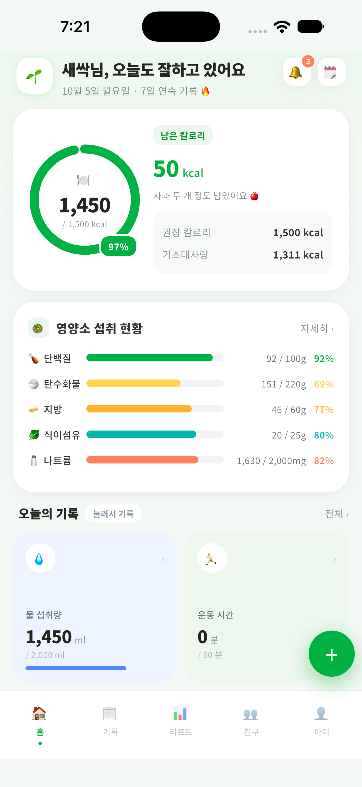
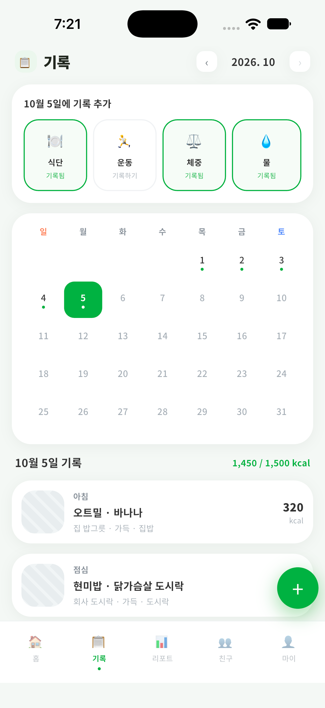
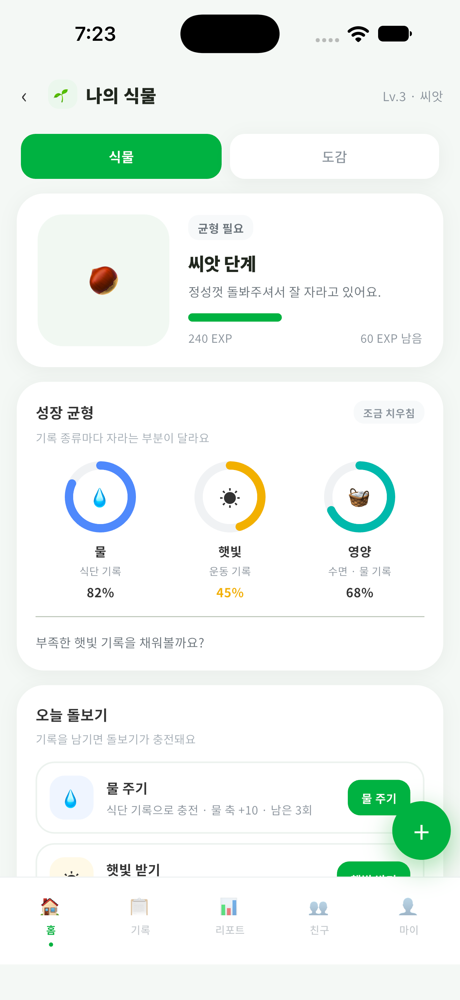
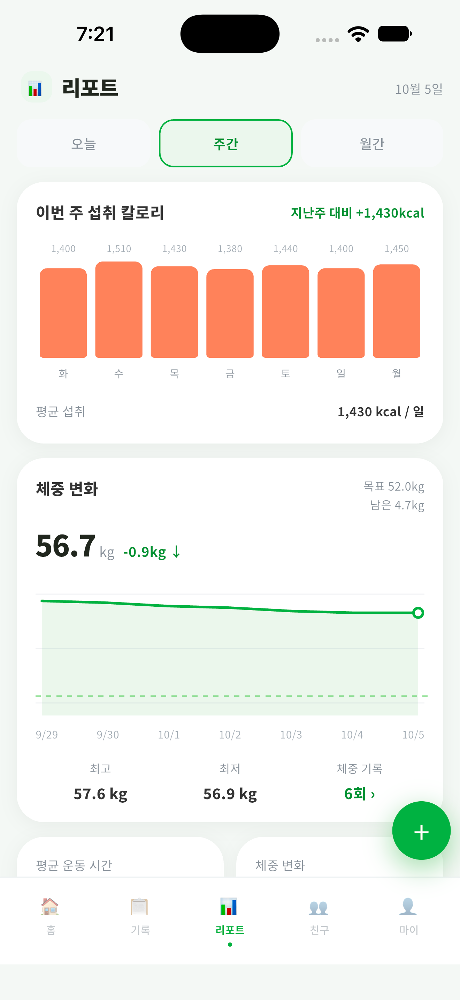
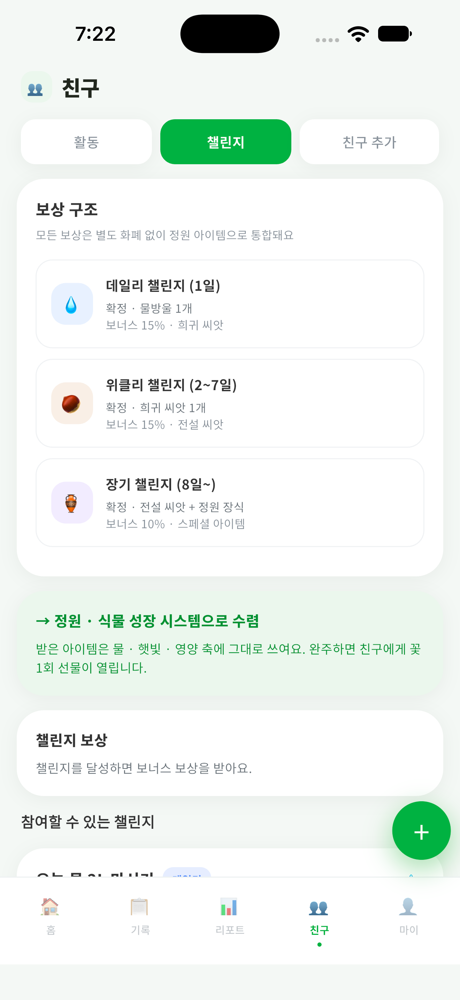
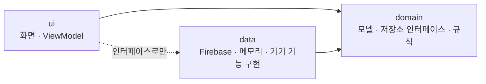
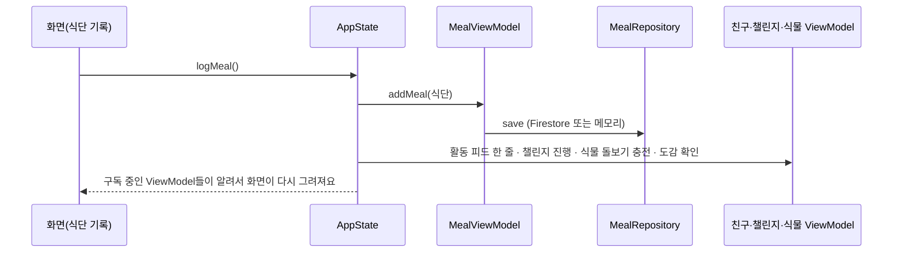
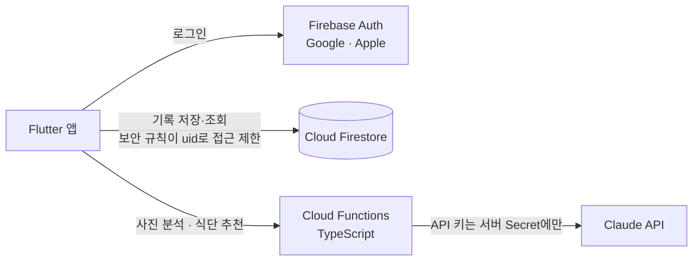

# 밋그린 (diet_project)

> 사진 한 장으로 끝나는 식단 기록, 그리고 기록할수록 자라는 식물.
> 식단 · 운동 · 물 · 체중을 한 앱에서 기록하고, 기록이 식물 성장으로 이어지는 다이어트 관리 앱이에요.

<p align="center">
  
  
  
  
  
</p>

| | |
|---|---|
| **iOS** | [App Store](https://apps.apple.com/kr/app/id6818954921) (2026-10-16 출시) |
| **Android** | Google Play 비공개 테스트 중 (일반 공개 전) |
| **웹 앱** | https://meatgreen.web.app — Google 로그인 후 실제 저장 (Apple 로그인은 iPhone · iPad에서만) |
| **웹 체험판** | https://diet-project-81ce1.web.app — 로그인 없이 예시 데이터로 둘러보기 (실제 저장 · AI 분석은 안 돼요) |
| **포트폴리오** | https://cr-kstar.github.io/diet_project/ |
| **정책 문서** | [개인정보 처리방침](https://cr-kstar.github.io/diet_project/privacy/) · [이용약관](https://cr-kstar.github.io/diet_project/terms/) · [계정 삭제 안내](https://cr-kstar.github.io/diet_project/delete-account/) · [건강 정보 출처](https://cr-kstar.github.io/diet_project/sources/) |

**목차**
[배경](#배경) · [주요 기능](#주요-기능) · [기술 스택](#기술-스택) · [아키텍처](#아키텍처) · [데이터와 서버](#데이터와-서버) · [시작하기](#시작하기) · [개발 명령](#개발-명령) · [테스트](#테스트) · [배포](#배포) · [폴더 구조](#폴더-구조) · [개인정보와 안전](#개인정보와-안전) · [알려진 한계와 계획](#알려진-한계와-계획) · [만든 방식](#만든-방식)

---

## 배경

기존 식단 기록 앱을 그만두는 이유는 대개 두 가지예요.

- **입력 비용** — 음식 이름 검색, 중량 입력, 1인분 추정을 매 끼니 요구하면 3일을 넘기기 어려워요.
- **동기 부족** — 숫자만 남는 기록은 계속할 이유를 만들어 주지 못해요.

밋그린은 기본 경로를 **사진 한 장**으로 줄이고, 정확도를 원하는 사람만 부가 정보를 고르게 해요.
그리고 기록을 **식물 성장**으로 바꿔서, 쉬어도 혼나지 않고 돌아오면 이어서 자라는 보상 구조를 만들었어요.

## 주요 기능

### 기록
- **식단** — 사진을 찍거나 고르면 AI가 음식 이름 · 칼로리 · 영양소 8종(단백질 · 탄수화물 · 지방 · 식이섬유 · 나트륨 · 당류 · 칼슘 · 철분)을 추정해요. 사진은 저장하지 않고 분석 결과만 기록으로 남겨요. 사진 없이 직접 기록할 수도 있어요.
- **식단 수정 · 삭제** — 기록 탭에서 식단을 눌러 상세에서 이름 · 칼로리 · 끼니를 고치거나 지울 수 있어요. 삭제는 확인을 한 번 거치고, 서버에서 지우지 못하면 목록에 되돌려 놓고 알려요. AI가 확신하지 못한 기록에만 ‘확인 필요’가 붙고, 고치거나 ‘맞아요’를 누르면 사라져요.
- **부가 정보 보정** — 단백질 종류 · 소스 · 조리법 · 탄수화물 · 끼니 · 상황을 칩으로 고르거나 직접 입력하면 보정 계수가 칼로리에 반영돼요. 양(전체 · 반절 · 1/3 · 직접 %)과 그릇에 담은 정도도 반영해요.
- **그릇 관리** — 자주 쓰는 그릇(이름 · 용량 · 재질 · 형태)을 등록하고 기본 그릇을 정해요. 그릇 크기가 AI 분석에 힌트로 전달돼요. 최대 20개.
- **운동 · 루틴** — 종류 · 시간 · 강도로 칼로리를 계산하고, 자주 하는 운동은 루틴으로 저장해 불러와요.
- **물 · 체중** — 컵 단위로 빠르게 기록(하루 목표 2,000ml)하고, 체중은 최근 7일 변화와 목표선으로 봐요.
- **기록 탭 달력** — 날짜별 기록을 보고, 지난 달로 넘겨 볼 수 있어요(미래 날짜는 고를 수 없어요).

### 계산
- **권장 칼로리** — 미플린–세인트 조르 공식으로 기초대사량을 구하고, 활동량 계수(1.2 / 1.375 / 1.55)를 곱한 뒤 감량 목표면 300kcal를 줄여요. 계산 방법과 출처는 [건강 정보 출처](docs/health-sources.md) 문서에 있어요.
- **홈 수치** — 먹은 칼로리 · 남은 칼로리(사과 몇 개 분량으로 풀어서 안내) · 영양소 8종 진행도 · 3대 영양소 비율.
- **리포트** — 주간 · 월간 칼로리 추이, 목표선이 있는 체중 그래프, 지난주(달) 대비 증감, 달성률, 자주 먹은 음식 · 그릇 · 소스, 가장 부족한 영양소와 한 줄 추천.

### 식물 성장
기록이 곧 성장이에요.

| 규칙 | 내용 |
|---|---|
| **돌보기 충전** | 물을 기록하면 *물 주기*, 운동하면 *햇빛 받기*, 식단을 기록하면 *영양 주기*가 1회씩 충전돼요 (최대 3 / 2 / 2회) |
| **돌보기 효과** | 누르면 경험치와 그 축 점수가 같은 만큼 올라요 (물 +10 · 햇빛 +15 · 영양 +20, 축은 최대 100) |
| **단계** | 경험치 100마다 1레벨. 씨앗(Lv.1) → 새싹(5) → 어린잎(10) → 무성한잎(15) → 꽃(20) |
| **균형** | 세 축의 점수 차이가 20 이하면 균형. 아직 아무것도 돌보지 않았으면 균형이라 부르지 않아요 |
| **시듦과 회복** | 기록을 이틀 쉬면 시들고, 오늘 기록하면 바로 회복해요. "회복 돌보기"를 누르면 그날 하루는 시들지 않아요. 시들어도 식물은 사라지지 않아요 |
| **친구 정원** | 친구 정원에 하루 3번까지 물을 줄 수 있고, 날짜가 바뀌면 다시 시작해요 |

### 식물 도감 (18종)
일반 · 희귀 · 전설 세 등급이에요. 열리는 조건은 식물마다 달라요.

- **기록 횟수 · 누적량으로 열려요** — 식단 30회(장미) · 물 10L(데이지) · 운동 10회(선인장) · 운동 300분(소나무) · 아침 식단 10회(벼) · 물 기록 50회(연꽃) · 체중 5회(대나무) · 연속 14일(몬스테라) · 첫 기록(새싹) · 누적 20회(고무나무) · 시작 안내 완료(튤립) · 축 100점(벚꽃) · 도감 80%(무궁화).
- **준비 중** — 균형 7일 유지, 미션 50회, 밤 기록, 챌린지 1위 3회, 씨앗 부화처럼 아직 기록을 셀 수 없는 5종은 "준비 중"으로 표시해요.
- 누적 횟수는 이 기능이 생긴 뒤의 기록부터 세요.

### 오늘의 미션
식단 · 운동 · 생활 · 꾸준함 네 카테고리에서 매일 3~5개가 뽑혀요. 같은 사용자와 같은 날이면 앱을 다시 켜도 같은 미션이 나오고, 진행도는 실제 기록에서 자동으로 계산돼요. 기록으로 못 채운 미션은 "달성 처리"로 완료할 수 있어요(경험치 지급, 날짜별로 기억).

### 친구 · 챌린지
- **초대 코드**(6자리)로 친구 요청을 보내고, 받은 사람이 수락해요.
- **챌린지**는 종류(물 · 운동 · 식단 기록 · 단백질), 하루 목표, 기간, 공개 여부, 보상을 정해 만들어요. 참가자 진행률로 순위를 보여줘요.
- **공개 범위**를 항목별로 정해요 — 식물 · 연속 기록 · 체중 변화 · 식단 사진 · 챌린지 순위.
- 친구 활동 피드에 "식단을 기록했어요" 같은 짧은 한 줄만 남겨요(정확한 수치는 남기지 않아요).

### 그 밖에
- **식단 추천** — 부족한 영양소 · 끼니 · 선호 · 최대 칼로리를 고르면 AI가 메뉴를 추천해요. 응답이 없거나 실패하면 규칙 기반 추천으로 대신해요.
- **알림** — 아침 기록 · 저녁 정리 · 주간 리포트 알림을 기기에 예약해요(시간은 설정에서 바꿔요). 서버 푸시는 쓰지 않아요.
- **동적 앱 아이콘** — 오늘 식단을 기록했는지에 따라 빈 그릇 ↔ 채운 그릇으로 바뀌어요(iOS 대체 아이콘 · Android activity-alias).
- **계정** — Google · Apple 로그인, 설정에서 계정과 모든 기록 삭제.
- **웹** — 웹 앱은 Google 로그인으로 실제 기록을 저장하고, 웹 체험판은 로그인 없이 예시 데이터로 둘러봐요.

## 기술 스택

| 영역 | 사용 기술 |
|---|---|
| 앱 | Flutter 3.44 (stable) · Dart 3.12 |
| 상태 관리 | Provider (`ChangeNotifier` ViewModel) |
| 인증 | Firebase Auth — Google 로그인 · Sign in with Apple (nonce) |
| 데이터베이스 | Cloud Firestore + 보안 규칙 |
| 서버 | Cloud Functions (TypeScript · Node 24) · Secret Manager |
| AI | Claude API (사진 → 영양 분석 · 메뉴 추천), zod 스키마로 응답 모양 강제 |
| 기기 기능 | `flutter_local_notifications` · `image_picker` · `shared_preferences` · `url_launcher` |
| 호스팅 | Firebase Hosting (웹 앱 · 웹 체험판) · GitHub Pages (정책 문서 · 포트폴리오) |
| 테스트 | `flutter_test` — 단위 · 위젯 430개 |

## 아키텍처

세 층으로 나누고, **참조는 한 방향**으로만 가요.



- `domain`은 Flutter도 Firebase도 화면도 몰라요. (모델 · 저장소 인터페이스 · 계산 규칙)
- `data`는 `domain`의 인터페이스를 구현해요. (`impl/` 폴더에 Firestore · 메모리 · Cloud Functions 구현)
- `ui`는 인터페이스만 알고, 어떤 구현을 쓸지는 `app_composition.dart`가 골라요.

자세한 규칙과 폴더 설명은 **[ARCHITECTURE.md](ARCHITECTURE.md)** 에 있어요.

### 상태 관리

- 화면마다 자기 **ViewModel**을 `context.watch<XxxViewModel>()`로 구독해요. (ViewModel 21개: 화면 이동 · 식단 · 식단 입력값 · 사진 분석 · 식단 추천 · 운동 · 그릇 · 루틴 · 물 · 체중 · 식물 · 친구 · 챌린지 · 미션 · 리포트 · 오늘 수치 · 기록 달력 · 알림함 · AI 동의 · 내 정보 · 로그인)
- **`AppState`**(약 1,300줄)는 모든 상태를 들고 있지 않아요. 여러 ViewModel을 엮는 동작(예: 식단 기록 → 활동 피드 · 챌린지 진행 · 앱 아이콘 · 식물 성장), 기기 알림 예약, ViewModel 연결만 맡아요.
- 다른 기록을 읽어 **계산만 하는 것**(리포트 · 미션 · 오늘 수치 · 달력)은 기록을 직접 들고 있지 않고, AppState가 넘겨 주는 값으로 계산해요. 기록이 바뀌면 AppState가 다시 계산하라고 알려요.
- 화면 이동은 `Navigator`가 아니라 `screen` 문자열 하나로 해요 (`NavigationViewModel.go(id)`).

### 식단을 기록하면 일어나는 일



### 테스트하기 좋은 구조

- 저장소 · 서비스는 인터페이스 뒤에 있어서, 테스트에서 **메모리 구현이나 가짜 구현**을 끼워요 (서버 · 카메라 · 기기 알림 없이).
- **시계를 주입**(`now: () => ...`)해서 날짜가 걸린 기능(연속 기록, 시듦, 미션, 리포트)도 고정해서 테스트해요.
- 사진 고르기도 주입(`PhotoPicker`)해서 갤러리 없이 분석 흐름을 테스트해요.

## 데이터와 서버



### Firestore 구조

```
users/{uid}                    프로필 문서 (닉네임 · 신체 정보 · 알림 · 공개 범위 · 약관 동의 · 온보딩 단계)
  ├─ weight / exercise / meals / bowls / routines / water   기록 (문서 하나 = 기록 한 건)
  ├─ plant/state             내 식물 (경험치 · 축 점수 · 돌보기 횟수 · 누적 기록 횟수 · 날짜 값)
  └─ dexEntries/{speciesId}  도감 (모았는지 · 진행도)

publicProfiles/{uid}         친구 찾기용 공개 정보 (닉네임 · 초대 코드)
inviteCodes/{code}           초대 코드 → uid
friendRequests/{id}          친구 요청 (보낸 사람 · 받은 사람 · 상태)
friendships/{pairId}         확정된 친구 관계
challenges/{id}              챌린지
challengeProgress/{id}       챌린지 참가자별 오늘 진행
activityFeed/{id}            친구 활동 피드 한 줄
```

- 내 기록은 `users/{uid}` 아래에 두어 규칙 한 줄로 하위 전체를 보호하고, 사용자 사이의 관계(친구 · 챌린지)는 최상위 컬렉션으로 빼요.
- 기록의 날짜는 `dateKey`('2026-10-18') 문자열로 저장해요. 사전순이 곧 시간순이라 월 단위 범위 조회가 한 필드 조건 하나로 되고 별도 색인이 필요 없어요.
- 모델 ↔ 저장 형식(Map) 변환은 `data`의 codec이 하고, 도메인 모델은 저장 방법을 몰라요 (`lib/data/repositories/record_codecs.dart`).

### 보안 규칙 (`firestore.rules`)
기본은 모두 막고 필요한 것만 열어요.

| 경로 | 읽기 | 쓰기 |
|---|---|---|
| `users/{uid}/**` | 본인만 | 본인만 |
| `publicProfiles` · `inviteCodes` | 로그인한 사용자 | 본인 것만 |
| `friendRequests` | 보낸 사람 · 받은 사람 | 생성은 보낸 사람, 수락 · 거절은 받은 사람, 삭제는 둘 다 |
| `friendships` | 관계에 포함된 두 사람 | 포함된 사람 |
| `challenges` | 로그인한 사용자 | 만든 사람이 `creatorId`로 생성 · 삭제, 참여를 위해 수정은 로그인한 사용자 |
| `challengeProgress` · `activityFeed` | 로그인한 사용자 | 본인(`uid`) 것만 (삭제도 본인 것만) |

### Cloud Functions (`functions/src/index.ts`)
- `analyzeMealPhoto` — 사진(base64)과 그릇 정보를 받아 음식 이름(한국어) · 칼로리 · 영양소 8종 · 확신도(`confidence`) · 재확인 필요 여부(`needs_review`)를 **정해진 JSON**으로 돌려줘요.
- `recommendMeals` — 부족한 영양소 · 끼니 · 선호 · 최대 칼로리로 메뉴 4~6개와 이유 · 점수를 돌려줘요.
- API 키는 코드나 앱에 넣지 않고 **Secret Manager**(`ANTHROPIC_API_KEY`)에만 둬요.
- 두 함수 모두 **로그인한 사용자만** 부를 수 있고(`unauthenticated`), 사용자별 **하루 30회**까지만 받아요(`resource-exhausted`, 한국 시간 자정에 초기화). 횟수는 서버가 Firestore `aiUsage`에 트랜잭션으로 세고, 보안 규칙에 열린 경로가 없어 앱에서는 읽거나 고칠 수 없어요. 사진은 8MB까지만 받아요.
- 사진과 식단 정보가 외부(Anthropic)로 나가므로, 앱은 **동의를 먼저 받고** 나서만 호출해요.

### 계정 삭제 흐름
`본인 확인(재인증)` → `Apple 토큰 철회(Apple 로그인일 때)` → `내 데이터 삭제(기록 · 프로필 · 친구 · 챌린지 · 활동 피드)` → `계정 삭제`.
데이터를 계정보다 먼저 지워요 — 계정을 먼저 지우면 보안 규칙이 삭제를 허용하지 않기 때문이에요. 한 번에 지울 수 있는 개수 한도 때문에 300개씩 나눠 지워요.

## 시작하기

### 준비물
- Flutter 3.44 (stable) · Dart SDK `^3.12.2`
- (iOS) Xcode — 최소 iOS 15.0
- (Android) Android Studio · SDK
- (서버 함수를 만질 때) Node 24 · [Firebase CLI](https://firebase.google.com/docs/cli)

### 1. 서버 없이 화면만 보기 (가장 빠른 방법)

```bash
flutter pub get
flutter run -d chrome --dart-define=USE_FIREBASE=false
```

`USE_FIREBASE=false`면 Firebase에 연결하지 않고, 가짜 로그인 · 메모리 저장소 · 예시 데이터로 동작해요. 로그인 버튼을 누르면 바로 들어가요. AI 사진 분석과 실제 저장은 되지 않아요.

### 2. 내 Firebase 프로젝트로 실행하기

이 저장소의 Firebase 설정 파일(`lib/firebase_options.dart`, `android/app/google-services.json`, `ios/Runner/GoogleService-Info.plist`)은 **원래 프로젝트용 클라이언트 설정**이에요(비밀 키가 아니에요). 직접 돌려 보려면 자기 프로젝트로 바꿔요.

1. [Firebase 콘솔](https://console.firebase.google.com/)에서 프로젝트를 만들고 **Authentication**(Google · Apple), **Firestore**를 켭니다.
2. 설정 파일을 새로 만들어요.
   ```bash
   dart pub global activate flutterfire_cli
   flutterfire configure
   ```
3. 보안 규칙을 올려요.
   ```bash
   firebase deploy --only firestore:rules
   ```
4. (AI 기능이 필요하면) 함수를 올려요. Anthropic API 키가 필요해요.
   ```bash
   cd functions && npm install && cd ..
   firebase functions:secrets:set ANTHROPIC_API_KEY
   firebase deploy --only functions
   ```
5. 실행해요.
   ```bash
   flutter run
   ```

Google 로그인은 플랫폼별 설정이 더 필요해요(Android는 SHA-1 지문 등록, iOS는 URL scheme). Apple 로그인은 Apple Developer 계정과 Firebase의 Apple 제공자 설정(서비스 ID · 키)이 필요해요.

## 개발 명령

```bash
flutter pub get                          # 의존성 설치
flutter analyze                          # 정적 분석
dart format lib test                     # 코드 정리
flutter test                             # 전체 테스트 (430개)
flutter test test/mission_view_model_test.dart       # 파일 하나만
flutter test --plain-name "시든다"                    # 이름으로 골라서

# 서버 함수
cd functions && npm run build            # TypeScript 컴파일
cd functions && npm run lint
firebase emulators:start --only functions

# 앱 아이콘 (assets/icon/app_icon.png 하나로 iOS · Android 아이콘 생성)
dart run flutter_launcher_icons
```

## 테스트

`flutter test`로 단위 · 위젯 테스트 430개를 한 번에 돌려요. 서버 없이 가짜 구현으로 돌아가요.

| 영역 | 확인하는 것 |
|---|---|
| ViewModel | 식단 · 운동 · 그릇 · 루틴 · 물 · 체중 · 식물 · 친구 · 챌린지 · 미션 · 리포트 · 오늘 수치 · 추천 · 사진 분석 · 식단 입력값 · 알림함 · AI 동의 · 내 정보 · 로그인 — 상태 변화, 저장 실패 처리, 알림 |
| 식물 성장 | 돌보기 충전 · 효과, 시듦 · 회복(고정 시계), 도감 조건 · 진행률, 친구 물주기 한도 초기화 |
| 저장 형식 | 모델 ↔ 저장 형식 변환, 예전 형식 · 깨진 값 읽기 |
| 계정 | 로그인 · 로그아웃 · 계정 삭제 순서와 실패 처리, 이전 계정 값이 남지 않는지 |
| 화면 | 화면이 자기 ViewModel을 구독하는지(ViewModel이 바뀌면 화면이 다시 그려지는지), 기록이 없는 새 계정에서 모든 화면이 오류 없이 그려지는지, 저장 버튼이 실제 저장까지 이어지는지, 식단 수정 · 삭제와 ‘확인 필요’ 표시 |

## 배포

- **iOS** — `flutter build ipa` 후 App Store Connect로 업로드. Sign in with Apple 권한 때문에 자동 내보내기가 안 되면(`flutter build ipa`가 아카이브까지만 만들고 실패해요) `xcodebuild -exportArchive -archivePath build/ios/archive/Runner.xcarchive -exportOptionsPlist ios/ExportOptions.plist -exportPath build/ios/ipa`로 수동 서명해서 내보내요(프로필 `DietProject AppStore`).
- **Android** — 업로드 키로 서명한 `flutter build appbundle --release` 결과를 Play Console에 올려요. 업로드 키 파일과 `android/key.properties`는 저장소에 없어요(`.gitignore`).
- **웹 체험판**(`diet-project-81ce1.web.app`) — `tool/build_web.sh demo` 후 `firebase deploy --only hosting:demo`.
- **웹 앱**(`meatgreen.web.app`, 실제 로그인 · 저장) — `tool/build_web.sh app` 후 `firebase deploy --only hosting:app`. 웹에서는 Google 로그인만 되고(Apple은 iPhone · iPad 전용), Firebase 승인된 도메인에 `meatgreen.web.app`이 있어야 해요.
- **서버** — `firebase deploy --only firestore:indexes`(색인), `firebase deploy --only functions`(AI 함수), `firebase deploy --only firestore:rules`(보안 규칙).
- **정책 · 포트폴리오 페이지** — `docs/` 폴더를 GitHub Pages로 공개해요.
- 버전은 `pubspec.yaml`의 `version`(예: `1.0.0+10`)이고, `+` 뒤가 빌드 번호예요. 스토어마다 같은 번호를 다시 쓸 수 없어요.

## 폴더 구조

```
lib/
  main.dart                  Firebase를 켜고 앱 시작
  app_composition.dart       어떤 구현(Firebase / 가짜)을 쓸지 고르는 곳
  app_state.dart             화면 이동 + 여러 ViewModel을 엮는 동작
  app_providers.dart         AppState와 모든 ViewModel을 화면에 내려줌
  app_shell.dart             하단 탭 · 빠른 기록 시트
  config/                    고정 설정값 (사이트 주소 · 함수 이름 · Firestore 컬렉션 이름)
  utils/                     날짜 · 숫자 포맷
  domain/
    models/                  모델 — 파일 하나에 클래스 하나 (models.dart로 한 번에 import)
    repositories/            저장소 인터페이스
    rules/                   계산 규칙 (칼로리 보정 · 식물 성장 · 도감 조건)
  data/
    auth/                    AuthService 인터페이스 · AuthFailure · impl/(Firebase · 가짜)
    repositories/            저장 형식 변환(codec) · impl/(Firestore · 메모리)
    services/                서비스 인터페이스 · impl/(Cloud Functions · 기기 알림 · 앱 아이콘 …)
  ui/
    core/ui/                 공용 위젯(위젯 하나에 파일 하나) · 아이콘 · 테마 토큰
    home · record · growth · social · report_settings · onboarding
                             <기능>/viewmodel/(ViewModel) · <기능>/pages/(화면)
functions/                   Cloud Functions (TypeScript)
firestore.rules              Firestore 보안 규칙
test/                        단위 · 위젯 테스트
docs/                        GitHub Pages — 정책 문서 · 포트폴리오 · 스크린샷
web/ · ios/ · android/       플랫폼 설정
```

## 개인정보와 안전

- **AI 분석은 동의 후에만** — 식사 사진과 식단 추천에 필요한 정보(부족한 영양소 · 선호 조건)가 외부 AI 서비스(Anthropic)로 전송돼요. 앱은 처음 쓸 때 동의를 받고, 설정에서 언제든 철회할 수 있어요. 동의하지 않아도 직접 입력해서 기록할 수 있어요.
- **사진은 저장하지 않아요** — 분석 결과만 기록으로 남아요.
- **계정과 모든 기록 삭제** — 설정에서 한 번에 지울 수 있어요(위의 계정 삭제 흐름). 친구 · 챌린지 · 활동 피드에 남긴 내 데이터도 함께 지워요.
- **친구에게 보이는 범위는 내가 정해요** — 항목별 공개 설정.
- **의료 서비스가 아니에요** — 칼로리 · 영양소 값은 AI 추정치이거나 일반적인 근사 계산이라 참고용이에요. 질환이 있거나 급격한 체중 조절을 계획한다면 전문가와 상담하세요. 계산 방법과 출처는 [건강 정보 출처](docs/health-sources.md)에 있어요.

## 알려진 한계와 계획

솔직하게 적어 둬요.

**보안 · 서버**
- Firestore 보안 규칙에 자동 테스트(에뮬레이터)가 아직 없어요.

**기능**
- 식물 도감 5종은 필요한 기록(균형 유지 일수 · 미션 횟수 · 시간대별 기록 · 챌린지 순위 · 씨앗 부화)이 아직 없어서 "준비 중"이에요.
- 도감 누적 횟수는 이 기능이 생긴 뒤의 기록부터 세요.
- 수면 기록이 없어요. 친구 삭제 · 신고 기능이 없어요. 알림함은 아직 앱 안 알림을 만들어 주는 기능이 없어서 비어 있어요(기기 알림은 동작해요).
- 식물 · 음식 그림은 이모지예요. 웹에서는 글꼴에 따라 네모로 깨져 보일 수 있어요(앱에서는 기기 글꼴로 표시돼요).

**구조**
- 크기 고정 상수(`theme_tokens.dart`)를 `ThemeData` / `ThemeExtension`으로 옮길 예정이에요.
- 화면 파일 일부가 1,000줄 안팎이라 더 쪼갤 수 있어요.

## 만든 방식

AI 코딩 도구(Claude Code)와 협업해 개발했어요. 기획 방향 · 검증 · 아키텍처 구조 분리 · 서버(DB · 보안 규칙 · 함수 · 인증) 설계 · 스토어 배포 · 심사 대응은 직접 진행했어요. 앱 아이콘 캐릭터는 AI로 생성했어요. 개발 과정의 설계 판단과 문제 해결은 [포트폴리오](https://cr-kstar.github.io/diet_project/)에 정리했어요.

## 문의

권채린 · kchaerin0811@gmail.com
